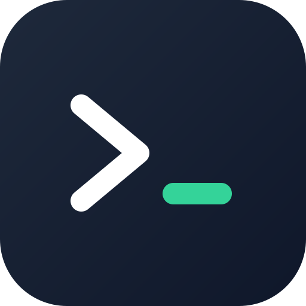
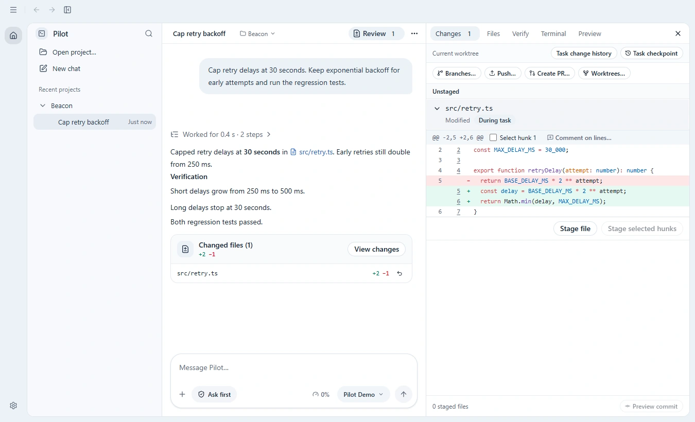

<div align="center">
  
  <h1>Pilot</h1>
  <p>面向开发者的桌面 AI 工作台</p>
  <p>在项目目录中与 Agent 协作，审查代码改动，运行验证，并从保存的会话继续工作。</p>
  <p>
    <a href="https://github.com/Murmureeee/Pilot/releases/latest"></a>
    <a href="https://github.com/Murmureeee/Pilot/actions/workflows/windows.yml"></a>
    <a href="./LICENSE"></a>
  </p>
  <p><a href="#下载安装">下载安装</a> · <a href="#快速开始">快速开始</a> · <a href="./CHANGELOG.md">更新记录</a> · <a href="./docs/README.en.md">English</a></p>
</div>

<p align="center">
  <picture>
    <source media="(prefers-color-scheme: dark)" srcset="./docs/images/pilot-workbench-dark.webp">
    
  </picture>
</p>

## 功能

- **从计划到交付**　先生成一份可审阅的计划，再授权执行。在同一窗口查看 Git 差异和验证结果，按文件或区块暂存并提交。
- **延续项目上下文**　重新打开会话后，可以找回草稿、工具轨迹和验证结果，并继续已中断的任务。不同工作区可并行运行，Git 工作树可隔离各自的改动。
- **控制 Agent 的权限**　按会话选择确认模式、只读或完全访问。审批会显示命令、路径或文件差异。危险命令始终逐次确认。
- **查看实际运行结果**　交互终端支持本地 Shell 和 Windows 上的 WSL 项目。预览页签可打开本机开发服务器，并把截图和控制台错误加入草稿。
- **扩展日常工作流**　配置项目钩子、只读定时任务、技能、插件和 MCP 服务。用量统计按天、项目或模型汇总已保存的 token 与费用。
- **选择模型与语言**　内置演示模型可直接体验。支持 Anthropic、OpenAI Responses、OpenAI 兼容端点，以及 Ollama 和 LM Studio。界面提供简体中文、繁体中文和 English。

## 下载安装

从发布页的 **Assets** 下载对应平台的安装包。 [下载最新版](https://github.com/Murmureeee/Pilot/releases/latest)

| 平台 | 文件 | 安装与更新 |
| --- | --- | --- |
| Windows x64 | `pilot-<版本号>-x64-setup.exe` | 运行安装程序。新版下载后可在应用内选择「更新并重启」。 |
| Linux x64 · AppImage | `pilot-<版本号>-linux-x86_64.AppImage` | 授予执行权限后运行。新版下载后可在应用内选择「更新并重启」。 |
| Linux x64 · Debian / Ubuntu | `pilot-<版本号>-linux-amd64.deb` | 用系统包管理器安装。应用可下载新版并打开下载位置。 |

从 **应用菜单 → 检查更新…** 可手动检查更新。Linux v0.5.0 及更早版本可从 Releases 手动安装一次新版。 [发行签名政策](./docs/CODE_SIGNING.md)

## 快速开始

1. **选择模型。** 首次打开时可以直接选择演示模型，也可以连接自己的模型服务。
2. **打开项目。** 从侧栏选择项目目录，在新聊天中描述你想完成的任务。输入 `@` 可引用项目文件。
3. **审查结果。** 用 `/plan` 先拟定计划，或直接开始任务。随后在右侧审查面板查看改动、运行验证并检查输出。

Codex 和 Claude Code 的技能、MCP 配置与插件组件可在 **设置 → 插件** 中预览和导入。

## 从源码运行

需要 Node.js 26、pnpm 11 和 Git。请先关闭正在运行的 Pilot Electron 开发实例，再在仓库根目录执行。 [工程约定](./AGENTS.md)

```bash
pnpm install --frozen-lockfile
pnpm dev
```

`pnpm run ci` 运行格式检查、类型检查、lint、单测和未用代码检查。构建桌面应用可运行 `pnpm build`，生成安装包可使用 `pnpm package:win` 或 `pnpm package:linux`。 [构建工作流](./.github/workflows/windows.yml)

## 文档与反馈

[路线图](./docs/PLAN.md) · [设计规范](./docs/DESIGN.md) · [开发记录](./docs/DEVELOPMENT_HISTORY.md) · [隐私说明](./docs/PRIVACY.md) · [报告问题](https://github.com/Murmureeee/Pilot/issues)

Pilot 使用 Electron 构建桌面应用，Agent 运行时基于 pi。 [pi](https://github.com/earendil-works/pi)

Pilot 的原创代码采用 MIT 许可证。随应用分发的第三方组件适用各自的许可证。 [MIT 许可证](./LICENSE)
