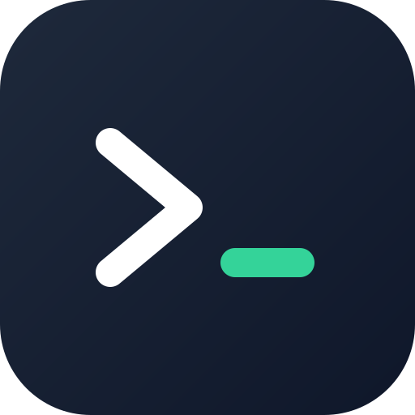
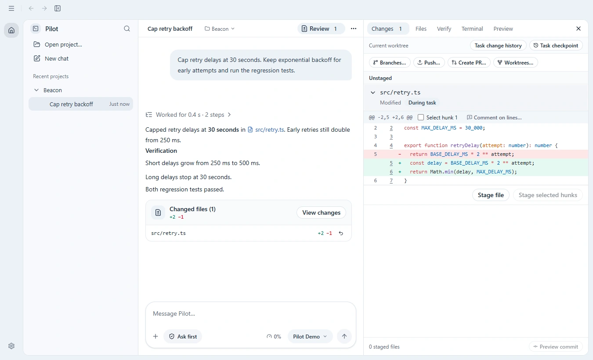

<div align="center">
  
  <h1>Pilot</h1>
  <p>A desktop AI workspace for developers</p>
  <p>Work with an agent in your project folder, review code changes, run checks, and resume saved conversations.</p>
  <p>
    <a href="https://github.com/Murmureeee/Pilot/releases/latest"></a>
    <a href="https://github.com/Murmureeee/Pilot/actions/workflows/windows.yml"></a>
    <a href="../LICENSE"></a>
  </p>
  <p><a href="#download">Download</a> · <a href="#quick-start">Quick start</a> · <a href="../CHANGELOG.md">Changelog (Chinese)</a> · <a href="../README.md">简体中文</a></p>
</div>

<p align="center">
  <picture>
    <source media="(prefers-color-scheme: dark)" srcset="./images/pilot-workbench-dark.webp">
    
  </picture>
</p>

## Features

- **Plan, review, and commit.** Review a proposed plan before authorizing execution. Inspect Git diffs and check results in the same window, then stage and commit files or individual hunks.
- **Pick up where you left off.** Reopen a conversation to recover drafts, tool traces, and check results or resume an interrupted task. Run tasks in parallel across workspaces and isolate changes in Git worktrees.
- **Control agent access.** Choose a per-chat approval mode. Review commands, paths, or file diffs when approving a tool request. Dangerous commands require approval each time.
- **See what ran.** Use the interactive terminal with local shells or WSL projects on Windows. Preview a local development server and attach screenshots and console errors to your draft.
- **Extend your workflow.** Configure project hooks, read-only scheduled tasks, skills, plugins, and MCP servers. View saved token usage and cost by day, project, or model.
- **Choose your models and language.** Try the built-in demo or connect Anthropic, OpenAI Responses, OpenAI-compatible endpoints, Ollama, or LM Studio. The interface supports Simplified Chinese, Traditional Chinese, and English.

## Download

Pick the package for your platform under **Assets**. [Download the latest release](https://github.com/Murmureeee/Pilot/releases/latest)

| Platform | File | Install and update |
| --- | --- | --- |
| Windows x64 | `pilot-<version>-x64-setup.exe` | Run the installer. After downloading an update, choose **Update and restart** in Pilot. |
| Linux x64 · AppImage | `pilot-<version>-linux-x86_64.AppImage` | Make the file executable and run it. After downloading an update, choose **Update and restart** in Pilot. |
| Linux x64 · Debian / Ubuntu | `pilot-<version>-linux-amd64.deb` | Install with your system package manager. Pilot can download the next package and open its location. |

Use **App menu → Check for updates…** to check manually. On Linux v0.5.0 or earlier, install a newer package from Releases once. [Code signing policy](./CODE_SIGNING.md)

## Quick start

1. **Choose a model.** On first launch, select the demo model or connect your model provider.
2. **Open a project.** Pick a folder in the sidebar and describe the task in a new chat. Type `@` to reference project files.
3. **Review the result.** Use `/plan` to draft a plan first, or start the task directly. Then open the review panel to inspect changes, run checks, and read the output.

Preview and import compatible skills, MCP configurations, and plugin components from Codex or Claude Code under **Settings → Plugins**.

## Run from source

Install Node.js 26, pnpm 11, and Git. Close any running Pilot Electron development instance, then run these commands from the repository root. [Repository guidelines](../AGENTS.md)

```bash
pnpm install --frozen-lockfile
pnpm dev
```

Run `pnpm run ci` for formatting, type checking, lint, unit tests, and unused-code checks. Run `pnpm build` for a desktop build, or use `pnpm package:win` or `pnpm package:linux` to create platform packages. [Build workflow](../.github/workflows/windows.yml)

## Documentation and feedback

[Roadmap (Chinese)](./PLAN.md) · [Design (Chinese)](./DESIGN.md) · [Development history (Chinese)](./DEVELOPMENT_HISTORY.md) · [Privacy policy](./PRIVACY.md) · [Report an issue](https://github.com/Murmureeee/Pilot/issues)

Pilot uses Electron for the desktop app and pi as its agent runtime. [pi](https://github.com/earendil-works/pi)

Pilot's original code is licensed under MIT. Bundled third-party components retain their own licenses. [MIT License](../LICENSE)
